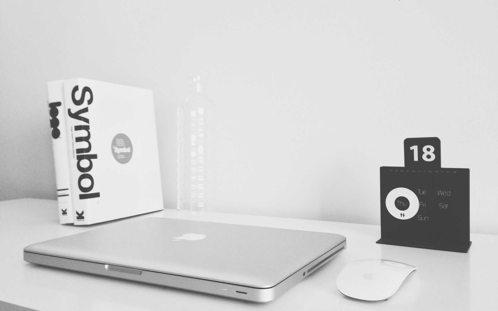

一个在手机上写代码的人。

## 现在在做什么

做一个只给自己用的日记 App「理砚」——不上架、没有账号、数据不出手机。同时在补它的相册功能，顺便把踩过的坑写成文章。

## 这个博客

用 [Hugo](https://gohugo.io/) 和 [Stack](https://github.com/CaiJimmy/hugo-theme-stack) 主题搭建，源码在 [GitHub](https://github.com/AdamsLy05/blog)，由 GitHub Pages 托管。

有意思的是，它最早是在一部 Android 手机上构建和发布的，没有用到电脑——这件事本身也写了一篇：[《在一部 Android 手机上跑 Hugo 和 Git》](/p/hugo-on-android/)。后来多了一台服务器，构建和发布挪到了那边（[《给手机配一台服务器》](/p/server-for-phone/)），手机上照样能改。

## 会写什么

- **技术**：做项目时踩过的坑，尤其是「查了半天才发现是这么回事」的那种
- **手机**：没有固定电脑的开发者，是怎么把活干完的
- **随笔**：生活里值得记一笔的片段

不追热点，不保证更新频率，想到就写。

## 联系

- GitHub：[AdamsLy05](https://github.com/AdamsLy05)
- 也可以在这个站的 [仓库](https://github.com/AdamsLy05/blog/issues) 里留言
